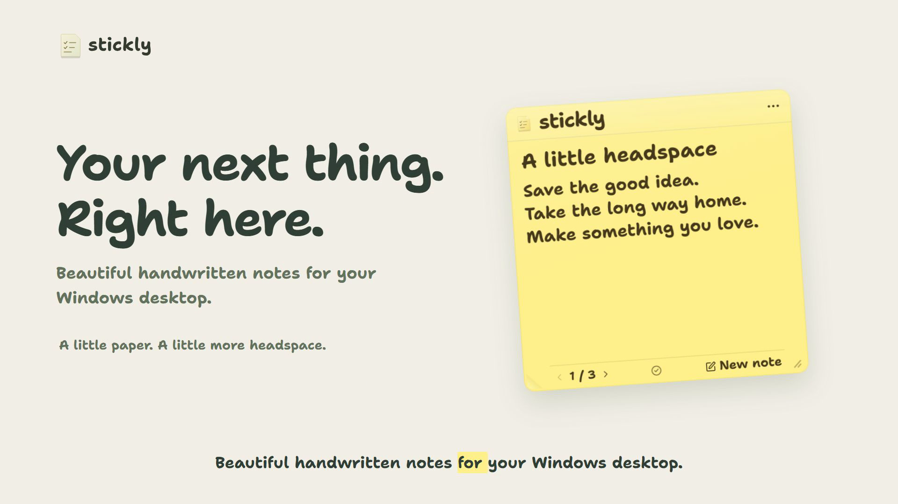
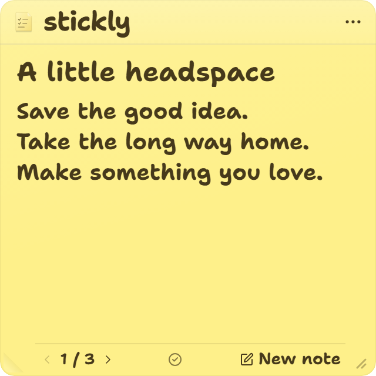
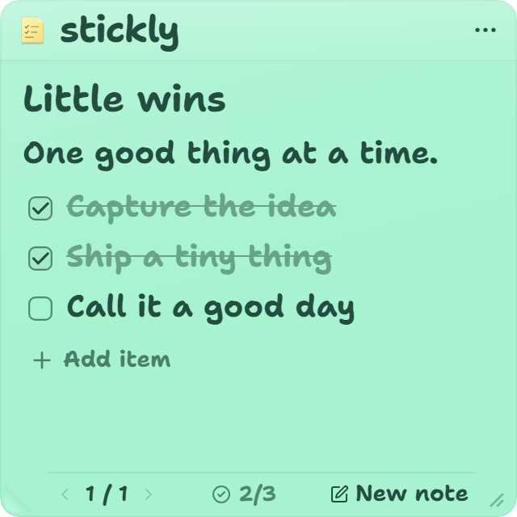
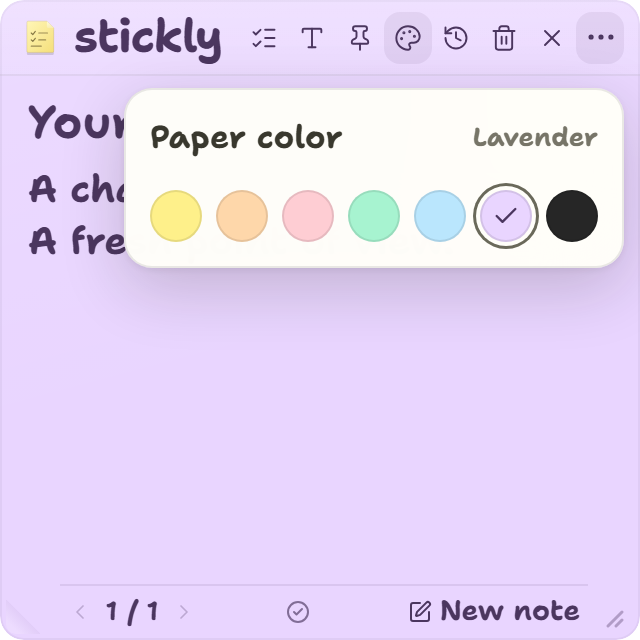
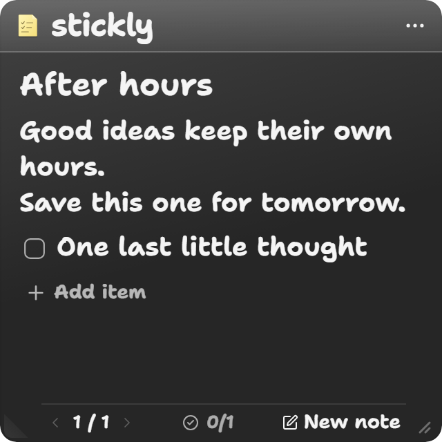
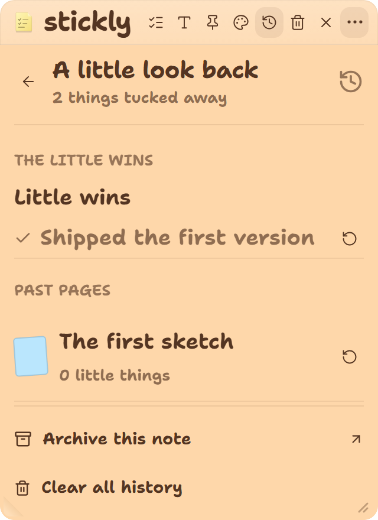
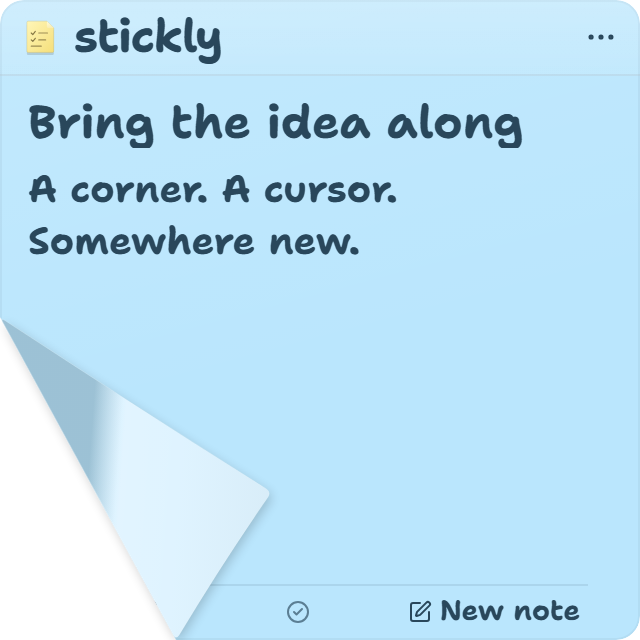

# Stickly

### A little corner for what matters next.

A thousand things on your mind? Give the next one a little paper. Stickly is a Windows desktop sticky note app for quick thoughts and optional checklists. Pick a paper color, pin a note above other windows, or peel it up and place it somewhere new. Your notes stay in local files on your PC.

<p align="center">
  <a href="docs/media/stickly-launch.mp4"></a><br>
  <a href="docs/media/stickly-launch.mp4">Watch the 30-second launch film</a> | <a href="docs/media/native-desktop-demo.mp4">Real Windows demo</a> | <a href="docs/index.html">Video index</a> | <a href="docs/media/README.md">Media kit</a>
</p>

**[Download Stickly for Windows](https://github.com/dhruvil-codes/stickly/releases/latest/download/Stickly-Setup.exe)**

Windows x64. A normal setup file with Start menu and desktop shortcuts. No Node.js, Rust, or terminal needed. This is an unsigned early preview; see the [release notes](https://github.com/dhruvil-codes/stickly/releases/latest).

[Install it](#install-stickly) · [See the controls](#quick-controls) · [Roadmap](docs/roadmap.md) · [Development guide](docs/development.md)

## A note can be a note

Start with a blank page. Add a checklist when you need one. Give each note a color and text size, then use the small page controls to move between notes in the same window.

| A quiet place for a thought | A short list for what's next |
|:--:|:--:|
|  |  |
| Plain note | Optional checklist |
|  |  |
| Pastel paper colors | Charcoal paper |
|  |  |
| Bring back a finished task or old note | Peel, carry, and place |

## What it does today

- Write a title and multiline note, with optional checklist items.
- Mark tasks complete, reopen them later, and archive or restore whole notes.
- Choose from seven paper colors and three text sizes.
- Keep the note above other windows, or hide and show it with **Alt+N**.
- Drag the lower-left corner to peel a note away, carry it, and click to place it. Press **Escape** to cancel while carrying.
- Use one compact window with previous and next controls to move between notes.
- Save notes locally in JSON, with a previous-save backup.

Writing uses the bundled Shantell Sans **Bold 700** weight. **Ctrl+B** switches the active note text or task to **ExtraBold 800**. There is no account or cloud sync.

## Install Stickly

1. [Download Stickly-Setup.exe](https://github.com/dhruvil-codes/stickly/releases/latest/download/Stickly-Setup.exe).
2. Open it and follow the setup steps. It installs for your Windows account.
3. Open **Stickly** from Start or the desktop shortcut. Press **Alt+N** to show or hide it.

Setup handles Microsoft WebView2 if it is missing; that first-time runtime download needs internet. Everyday note taking works offline. Existing notes stay in `%APPDATA%\stickly` when you install a newer version.

For updates, run the latest setup again. To uninstall, use **Windows Settings > Apps > Stickly**. See the [installation guide](docs/installation.md) for checksums and troubleshooting.

## Build from source

To develop Stickly or build your own installer, install Node.js 22.12 or newer, Rust stable, Microsoft C++ Build Tools with the Desktop development with C++ workload, and the WebView2 Runtime. See the official [Tauri Windows prerequisites](https://v2.tauri.app/start/prerequisites/#windows).

```powershell
git clone https://github.com/dhruvil-codes/stickly.git
cd stickly
npm ci
npm run tauri dev
```

The first install and Rust build need internet access. After that, Stickly works offline. For a local browser preview instead, run `npm run dev`; that preview saves to browser localStorage and does not include Windows shortcuts, tray controls, pinning, or native file storage.

To build the Windows executable and NSIS installer, run `npm run desktop:build`. Build outputs are under `src-tauri/target/release/`. They are unsigned unless you configure code signing.

## Quick controls

| Do this | With this |
|---|---|
| Show or hide the app | **Alt+N**, or use the system tray |
| Create a note | **Ctrl+N**, New note, or the tray menu |
| Move between notes | Use the small arrows and page counter at the bottom |
| Move the window | Drag blank paper, the header, or the logo |
| Resize the window | Drag the lower-right grip |
| Add a task | Expand the toolbar and choose Add a task |
| Change paper or text size | Expand the toolbar and open the picker |
| Keep the note in front | Use the pin control |
| Archive a note | Open History and choose Archive this note |
| Delete a note | Expand the toolbar, choose the trash control, then confirm |
| Quit the app | Choose Quit in the tray menu; closing the note hides it |

To move a note, pull its lower-left corner until the whole sheet lifts. Release, move to the new spot, then click to place. A short pull springs back. **Escape** cancels a carried note and restores its previous position. The placement click does not pass through to another app.

## Your notes and your files

The Windows app stores data here:

```text
%APPDATA%\stickly\data.json
%APPDATA%\stickly\data.backup.json
```

These plain JSON files contain note text, tasks, colors, text sizes, archive history, pin state, and the window position. They are not encrypted. Stickly has no application server, analytics client, or cloud sync. Window size is not saved yet.

Rust validates saves, writes them atomically, and keeps the previous successful snapshot as `data.backup.json`. If the current file cannot be read, Stickly leaves it untouched rather than overwriting it.

To restore the backup, quit Stickly first. Copy both files somewhere safe, keep the existing `data.json`, then copy `data.backup.json` over `data.json`. Keep a copy of the full folder before changing saved files.

## Known limits

- Windows is the only verified desktop target. macOS and Linux builds are not verified or distributed.
- The Windows installer is an unsigned early preview. Automatic updates and code signing are not available yet.
- Stickly uses one app window for all notes; separate note windows are not available.
- Notes live on this PC. There is no sync, account, or Microsoft Sticky Notes import.
- The project has not selected a license for its own source code. Third-party fonts and packages keep their own licenses; see [third-party notices](THIRD_PARTY_NOTICES.md).

## FAQ

### Is Stickly open source?

The source is public, but a project-wide source license has not been selected. Third-party fonts and dependencies retain their own licenses. See [third-party notices](THIRD_PARTY_NOTICES.md).

### Where are Stickly notes stored?

The Windows app saves them in `%APPDATA%\stickly\data.json`. It keeps the previous successful save in `data.backup.json`. Browser preview data is stored separately in localStorage.

### Does Stickly need an internet connection?

The app does not need an account, server, or internet connection for everyday note taking. Installing dependencies and building from source require internet access. Windows provides the WebView2 Runtime.

### Can I use Stickly for plain notes?

Yes. Notes start as plain text. Add a checklist only when you want one, and use both in the same note.

### Does each note open in its own window?

No. All notes live in one window. Use the arrows and page counter at the bottom to switch pages.

### Does Stickly sync with Microsoft Sticky Notes or OneNote?

No. It has its own local JSON files. Import, OneNote integration, and cloud sync are not implemented.

### Can I install Stickly with a signed setup file?

The [Windows setup](https://github.com/dhruvil-codes/stickly/releases/latest/download/Stickly-Setup.exe) is available, but it is not code-signed yet. Windows may warn about an unrecognized publisher. You do not need developer tools to install it.

## Fonts, artwork, and project notes

Stickly bundles Shantell Sans Bold 700 and ExtraBold 800. The font is under the [SIL Open Font License 1.1](src/assets/fonts/ShantellSans-OFL.txt); credits are in [third-party notices](THIRD_PARTY_NOTICES.md). The note mark and wordmark SVGs are in `public/`.

For development commands, native Windows checks, and troubleshooting, read the [development guide](docs/development.md). The [architecture guide](docs/architecture.md) maps the renderer, storage, and native peel behavior. Report reproducible bugs in [GitHub Issues](https://github.com/dhruvil-codes/stickly/issues); include Windows version and display scaling, and use synthetic note text in screenshots.
