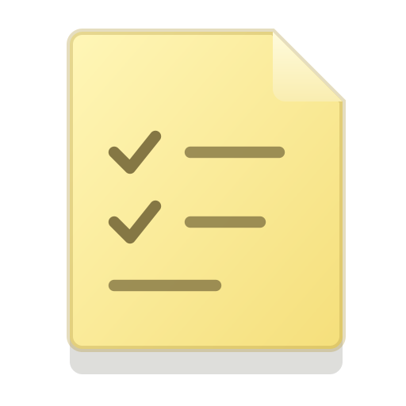
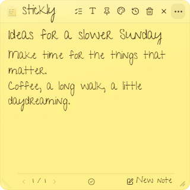

<p align="center">
  
</p>

# Stickly: offline sticky notes for Windows

Stickly is a compact Windows desktop sticky note app for quick thoughts, reminders, and optional to-do lists. Write directly on handwritten paper, keep a note always on top, or peel it from a corner and place it somewhere else on your desktop.

Built with **Tauri v2, Rust, React 19, TypeScript, and GSAP**. Notes stay on your computer. No account or cloud service is required.

[Get started](#run-stickly-from-source) · [Controls](#everyday-controls) · [FAQ](#frequently-asked-questions) · [Development](docs/development.md) · [Architecture](docs/architecture.md)

> Version 0.1.0 is an early Windows release. Build from source using the instructions below. This repository does not currently provide a signed production installer. macOS and Linux desktop support have not been verified.

<p align="center">
  
</p>

## What Stickly does

| Feature | Behavior |
| --- | --- |
| Plain notes | Write multiline text with an editable title. Add checklists only when you need them. |
| Optional to-do lists | Add, edit, complete, reopen, and delete tasks. Completed items have a hand-drawn strikethrough. |
| Tactile paper peel | Pull the lower-left corner at your own pace. A fully detached, curled note follows the cursor until you click to place it. |
| Normal window dragging | Drag blank paper, the header, or the logo mark. Editors and buttons keep their usual interactions. |
| Compact, resizable window | Starts at 320 × 320 logical pixels, with a 240 × 200 minimum. The lower-right grip resizes separately from peeling. |
| Collapsible controls | The three-dot button folds the toolbar into one control. Compact page navigation stays at the bottom. |
| Paper colors | Classic yellow, pastel peach, blush pink, mint green, sky blue, lavender, and charcoal. |
| Text size and bold | Choose S, M, or L per note. Ctrl+B toggles bold in the active note body or task. |
| History and archive | Restore completed tasks and archived notes, or clear history with confirmation. |
| Desktop controls | Alt+N toggles visibility. Pin a note above other windows, or use the system tray to show, hide, create, and quit. |
| Local persistence | Rust saves notes and preferences to a local JSON file, with atomic replacement and a previous-snapshot backup. |

Overflowing content scrolls with the mouse wheel, trackpad, or keyboard. Scrollbars stay hidden, and text wraps within the note width. The interface respects reduced-motion preferences.

## Run Stickly from source

### Windows prerequisites

- Node.js 22.12 or newer and npm.
- The current stable Rust toolchain, installed with [rustup](https://rustup.rs/).
- Microsoft C++ Build Tools with the Desktop development with C++ workload and Windows SDK.
- Microsoft Edge WebView2 Runtime.

Follow the official [Tauri Windows setup guide](https://v2.tauri.app/start/prerequisites/#windows) for native dependencies. The first dependency installation and Rust compilation require internet access.

```powershell
git clone https://github.com/dhruvil-codes/stickly.git
cd stickly
npm ci
npm run tauri dev
```

### Build a Windows installer

```powershell
npm run desktop:build
```

The release executable is `src-tauri/target/release/stickly.exe`. The NSIS installer is generated under `src-tauri/target/release/bundle/nsis/`.

Builds are unsigned unless the distributor configures code signing. A production distribution still needs signing and native validation on its supported Windows versions and display configurations.

### Browser development

```powershell
npm run dev
```

Open `http://localhost:1420`. The browser preview stores notes in localStorage. Global shortcuts, the tray, pinning, native window movement, and JSON file persistence require the Tauri desktop app.

## Everyday controls

| Action | How |
| --- | --- |
| Show or hide Stickly | Alt+N from any app, or Show / Hide in the tray menu. |
| Create a note | New note, Ctrl+N, or New Note in the tray menu. |
| Switch notes | Use the small previous/next arrows around the page counter. |
| Move the window | Drag blank paper, the header, or the logo mark. |
| Resize | Drag the lower-right grip. |
| Expand the toolbar | Click the three-dot button. Stickly remembers the choice. |
| Add a task | Click Add a task in the expanded toolbar. |
| Add the next task | Press Enter in a task. Shift+Enter adds a line break. |
| Toggle bold | Ctrl+B in the active task or note body. |
| Remove a task | Click its hover-revealed delete button, or Backspace on an empty task. |
| Delete the current note | Use the trash button. Nonempty notes ask for confirmation. |
| Archive a note | Open History and archive, then Archive this note. |
| Keep a note above other apps | Use the pin control. |
| Choose paper or text size | Open Paper color or Text size. Click the note to close the picker. |
| Quit completely | Choose Quit in the tray menu. Closing the note hides it to the tray. |

With the logo or resize grip focused, arrow keys move or resize in 10-pixel steps. Shift+arrow uses 1-pixel steps.

### Peel and place a note

1. Grab the lower-left paper corner and pull inward. The crease follows the distance and direction of your drag. Pause to hold it, or reverse the drag to undo it.
2. Release a short pull to let the corner spring flat. Keep pulling to detach the entire sheet.
3. Once detached, the half-curled sticker stays attached to the cursor. Release the mouse button, move to a new spot, and click to apply it there.
4. Press Escape during carry to return to the original position.

Space on the focused peel corner starts the keyboard version. Alt-drag can start peeling over an editor. During native carry, temporary Windows mouse and Escape hooks track placement and cancellation. The placement click is consumed so it does not activate the app underneath.

## Local storage and privacy

The desktop app saves its data here:

```text
%APPDATA%\stickly\data.json
%APPDATA%\stickly\data.backup.json
```

The save contains note titles and text, tasks, colors, text sizes, archive history, pin state, and physical window position. The backup holds the previous successful snapshot. Window size is not currently persisted.

Stickly validates save data before loading it. Rust serializes background writes and replaces files atomically. An unreadable or incompatible save is left untouched rather than overwritten. Tray Quit flushes pending saves before exiting.

These files are **plain JSON, not encrypted**. Protect them with your Windows account and disk security. Stickly has no application server, analytics client, or cloud sync. Browser-preview data is separate from desktop data.

To recover a backup, quit Stickly, copy both files somewhere safe, preserve the damaged `data.json`, and copy `data.backup.json` to `data.json`. Back up the whole directory before editing or moving saved data.

## Development and validation

```powershell
npm test
npm run build
npm run test:e2e
cargo test --manifest-path src-tauri/Cargo.toml --test storage --test carry --locked
cargo clippy --manifest-path src-tauri/Cargo.toml --all-targets --locked -- -D warnings
```

Playwright uses installed Microsoft Edge on Windows. If Edge is unavailable, install Chromium with `npx playwright install chromium`.

The tests cover note and task state, save validation and migration, fold geometry, browser editing and persistence, colors and text sizes, archive restoration, pointer interactions, and Rust storage and carry transitions. Browser tests do not replace physical desktop testing of Windows global input hooks, DPI scaling, and multiple monitors.

See [the development guide](docs/development.md) for native test helpers, manual checks, and troubleshooting. See [the architecture guide](docs/architecture.md) for the renderer, native commands, storage, and peel geometry.

## Frequently asked questions

### What is Stickly?

Stickly is a Windows sticky note and to-do app built with Tauri and Rust. It combines local handwritten notes, optional checklists, an always-on-top window, and an interactive paper peel.

### Does Stickly work offline?

Yes. Once installed, note editing and desktop controls work without an account or application server. Dependency installation and builds need access to package registries. Windows manages its own WebView2 runtime separately.

### Where does Stickly save my notes?

The Windows desktop app saves notes in `%APPDATA%\stickly\data.json`, with the previous successful snapshot in `data.backup.json`. The browser preview uses localStorage instead.

### Does New note open a separate desktop window?

No. This version keeps multiple notes in one desktop window. New note creates a page, and the compact page counter and arrow buttons switch between active notes.

### Can I use Stickly for plain text instead of to-do lists?

Yes. New notes start as plain text. Add checklist items only when you want them, and keep paragraphs and tasks in the same note.

### Can I resize Stickly or keep it always on top?

Yes. Drag the lower-right resize grip and use the pin button to toggle always on top. The minimum window size is 240 × 200 logical pixels.

### Does Stickly replace Microsoft Sticky Notes data or sync with OneNote?

No. Stickly is an independent desktop app with its own local JSON storage. Microsoft Sticky Notes import, OneNote integration, cloud sync, and collaboration are not implemented.

### Is Stickly available for macOS or Linux?

Windows is the current desktop target. The compact controls take inspiration from macOS, but native macOS and Linux builds are not verified or distributed.

## Fonts and artwork

**Give You Glory**, by Kimberly Geswein, is bundled locally for all interface text, note writing, and the wordmark. The app does not fetch fonts at runtime. The supplied font has one weight, so bold uses browser synthesis. The font is distributed under the [SIL Open Font License 1.1](src/assets/fonts/GiveYouGlory-OFL.txt), with credits in [third-party notices](THIRD_PARTY_NOTICES.md). Personal-use Matcha Salt files are excluded from the public repository.

The original [SVG note mark](public/stickly.svg), [outlined wordmark](public/stickly-wordmark.svg), and [complete logo](public/stickly-logo.svg) live in `public/`. To regenerate the outlined artwork, install Python and FontTools, then run:

```powershell
python -m pip install fonttools
python scripts/create-wordmark.py --font src/assets/fonts/GiveYouGlory-Regular.ttf
```

## Project licensing

A project-wide source license has not been selected. Third-party fonts and dependencies retain their respective licenses; their availability does not license Stickly's own source code. See [third-party notices](THIRD_PARTY_NOTICES.md).

## Contributing and reporting issues

Read [the development guide](docs/development.md), keep changes focused, and include the checks you ran. Report bugs in [GitHub Issues](https://github.com/dhruvil-codes/stickly/issues) with reproduction steps, the Windows version, display scaling, and expected behavior. Use synthetic note text in screenshots and reports.

For a concise factual project index, see [llms.txt](llms.txt).
